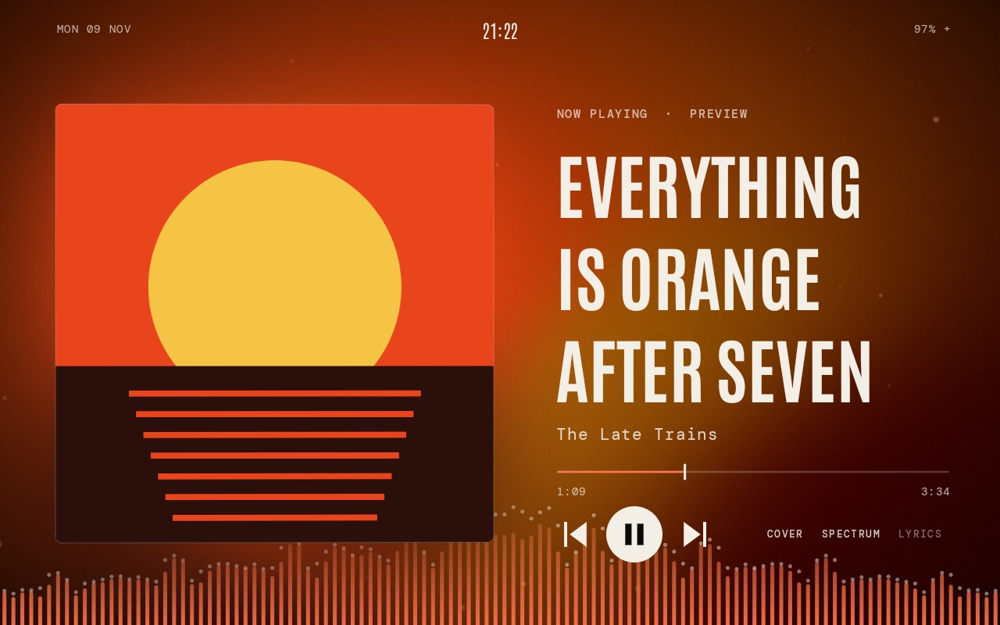
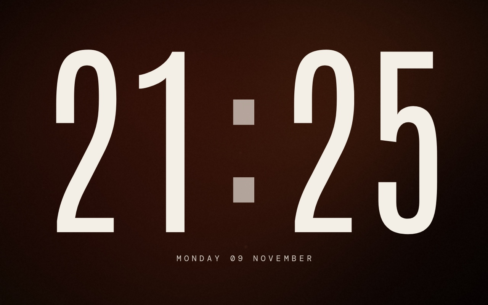
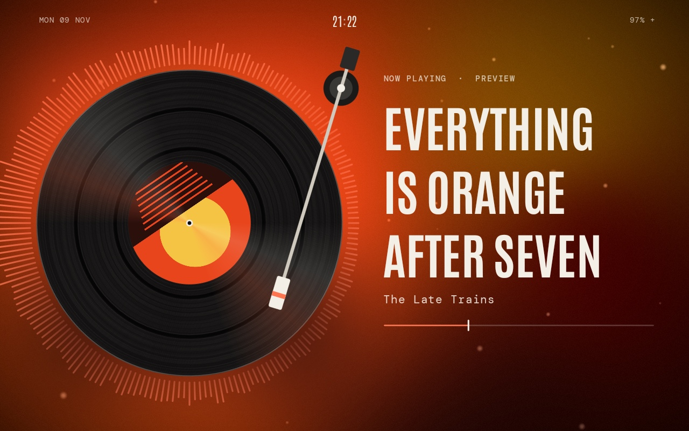
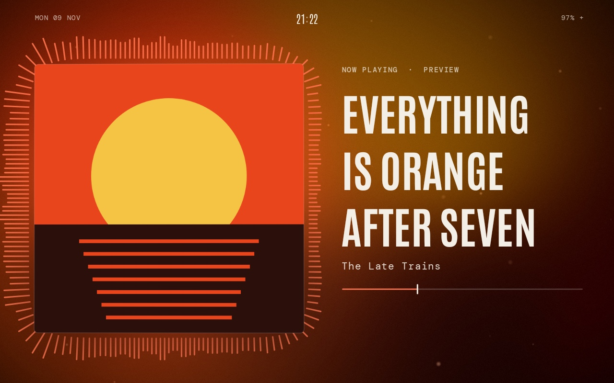
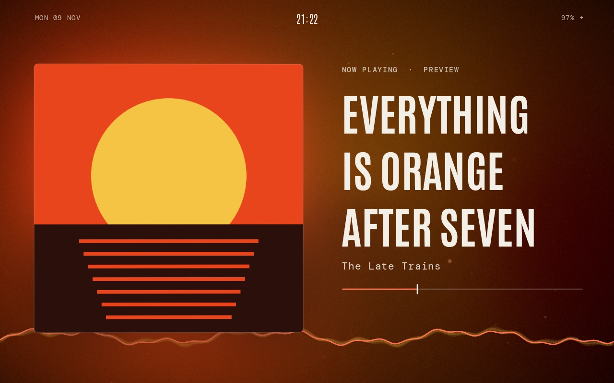

# Afterglow

Afterglow turns an Android tablet on a stand into a clock that wakes up when music plays. The time fills the screen when nothing is playing. Start a song in Spotify, YouTube Music or another player, and the clock shrinks to the top while the cover art, title and a moving background built from the cover's colours take over.



## Screens

| Clock | Vinyl with Halo |
| --- | --- |
|  |  |

| Cover with Halo | Scope |
| --- | --- |
|  |  |

Screenshots were taken on a Galaxy Tab A 8.0 using the app's Preview mode, so the album and artist are made up.

## Features

- **Poster clock:** a large rolling clock with colours that follow the time of day, plus the next alarm if one is due within 24 hours.
- **Colours from the cover:** the background is a slow-moving gradient made from five colours picked out of the album art.
- **Reacts to the music:** the background, dust and visuals respond to the tablet's actual sound output.
- **Four visualizers:** Spectrum, Halo, Scope and Ridge, or turn them off.
- **Cover or vinyl:** show the album art, or a spinning record whose tonearm follows the song's progress.
- **Synced lyrics:** optional, fetched from [LRCLIB](https://lrclib.net) and off by default.
- **Opens by itself:** comes to the front 3 seconds after a music app starts playing.
- **Night dim:** lowers the brightness on the clock from 11 PM to 6 AM.

Afterglow reads the song from Android's media sessions, so it can work with most players. Display names and auto-open are set up for Spotify, YouTube Music, JioSaavn, Gaana, Wynk, SoundCloud, Apple Music, Amazon Music, Samsung Music and Poweramp. YouTube is recognised too, but doesn't trigger auto-open.

## Gestures

| Gesture | Action |
| --- | --- |
| Tap | Show or hide the controls |
| Double tap | Play or pause |
| Swipe left or right | Next or previous song |
| Long press | Open Setup |

## Requirements

- Android 11 (API 30) or newer
- A tablet in landscape. The layout is designed for a 1280×800 screen and scales with its height.

## Build and install

The repo doesn't include the Gradle wrapper, so you need Gradle 8.14 or newer, JDK 21 and the Android SDK. Android Studio can provide all three.

Create `local.properties` in the project root with the path to your SDK:

```properties
sdk.dir=/path/to/Android/sdk
```

Build the app:

```bash
gradle :app:assembleRelease
```

Install it on a connected tablet:

```bash
adb install -r app/build/outputs/apk/release/app-release.apk
```

The release build is signed with the debug key, which is fine for your own device but not for publishing.

## Setup on the tablet

Open the app and long-press the screen to reach Setup. Each row links to the Android setting it needs.

| Setup row | Android permission | What it's for |
| --- | --- | --- |
| Song info and controls | Notification access | Reads the current song and sends play, pause and skip |
| React to the music | Microphone | Reads the tablet's sound output for the visuals |
| Open when music starts | Display over other apps | Brings Afterglow to the front when music starts |

The microphone is never opened. Android files access to the audio output under the Microphone permission. Choose **Allow only while using the app**, because **Only this time** is removed soon after you leave the app. Without this permission the visuals still move, but they use simulated audio.

To see the playing screen without any music, choose **Preview** in Setup or run:

```bash
adb shell am start -n com.anshyadav.afterglow/.MainActivity --ez preview true
```

## How it's built

Afterglow is written in Kotlin with no AndroidX or other runtime libraries.

| File | Job |
| --- | --- |
| `MediaHub.kt` | Finds the active player and tracks the song through a notification listener |
| `AudioEngine.kt` | Turns Android's `Visualizer` output into frequency bands, a waveform and beats |
| `ArtAnalysis.kt` | Picks the palette from the album art using k-means clustering in OKLab |
| `AmbientView.kt` | Draws the background and dust in OpenGL ES 2 |
| `ArtView.kt` | Draws the cover and the vinyl record |
| `VisualizerView.kt` | Draws the visualizers |
| `Widgets.kt` | Clock, poster title, progress bar, buttons and lyrics |
| `MainActivity.kt` | Screen layout, animation between modes, gestures and Setup |

## Credits

[Antonio](https://fonts.google.com/specimen/Antonio) and [DM Mono](https://fonts.google.com/specimen/DM+Mono) are used under the SIL Open Font License. Lyrics come from [LRCLIB](https://lrclib.net).
